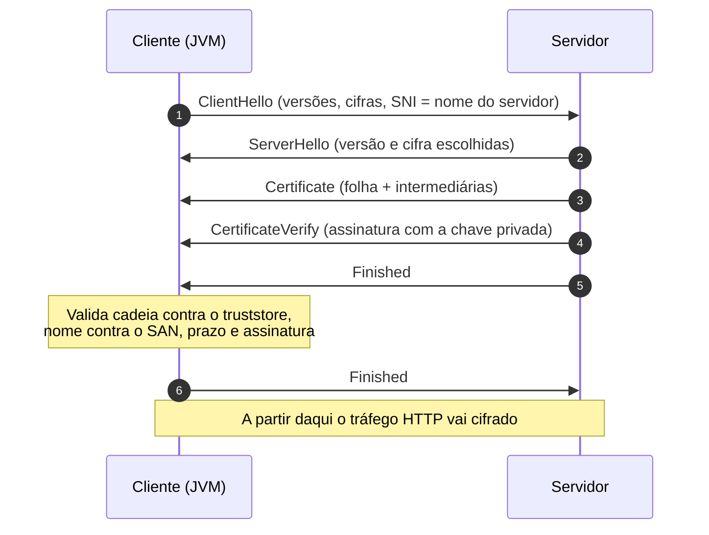
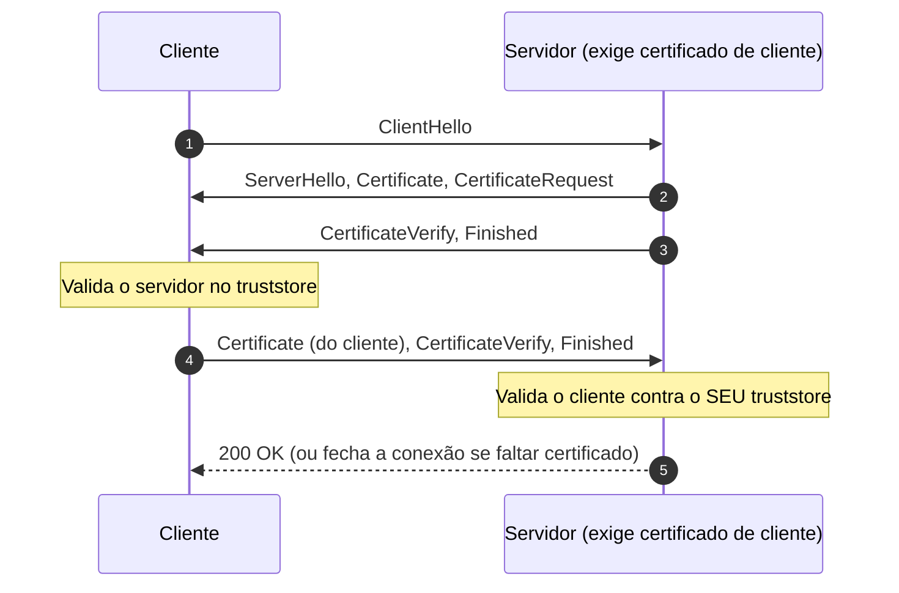

# 03 · TLS e mTLS

**[← 02 · Certificados e PKI](02-certificados-e-pki.md) · [Sumário](../README.md) · [04 · Java: keystore, truststore e `cacerts` →](04-java-keystore-truststore.md)**

> **Analogia:** o banco (cliente) recebe o documento com selo (certificado). Ele confere se o cartório está na sua lista, se o nome bate e se o selo está no prazo. Em seguida pede: "assine **agora** esta frase aleatória" (prova de posse da chave privada). Só então conversam em um canal fechado. Em **mTLS** o banco também precisa mostrar um documento com selo para o servidor.

## O que o TLS garante

1. **Autenticidade** do servidor (e, em mTLS, do cliente).
2. **Confidencialidade** do tráfego.
3. **Integridade** (ninguém altera no caminho).

## Handshake (visão TLS 1.3)



O ponto central é o passo 4: o `CertificateVerify` é a **prova de posse** da chave privada. Copiar o certificado público não ajuda um impostor.

## mTLS (cliente também se identifica)



Cada lado precisa de **dois** materiais: um **keystore** (quem sou) e um **truststore** (em quem confio). No mTLS, o servidor também tem truststore para validar clientes.

## Validação que o cliente faz (ordem prática)

```
1. A cadeia fecha em uma raiz presente no truststore?          → senão: PKIX path building failed
2. Cada certificado está dentro da validade?                    → senão: certificate expired
3. O nome da URL aparece no SAN da folha?                       → senão: No subject alternative names matching ...
4. O EKU permite serverAuth?                                    → senão: erro de uso do certificado
5. A assinatura do CertificateVerify confere com a chave pública da folha?
```

## Código: servidor HTTPS e cliente (JDK puro)

Arquivos: [`Servidor.java`](../labs/tls-java/Servidor.java) e [`Cliente.java`](../labs/tls-java/Cliente.java).

```java
// SERVIDOR: keystore = "quem sou eu" (+ truststore opcional para mTLS)
KeyStore ks = KeyStore.getInstance("PKCS12");
try (var in = Files.newInputStream(Path.of(keystore))) { ks.load(in, senha); }
KeyManagerFactory kmf = KeyManagerFactory.getInstance(KeyManagerFactory.getDefaultAlgorithm());
kmf.init(ks, senha);

SSLContext ctx = SSLContext.getInstance("TLS");
ctx.init(kmf.getKeyManagers(), tmf /* null se não há mTLS */ == null ? null : tmf.getTrustManagers(), null);

HttpsServer srv = HttpsServer.create(new InetSocketAddress(porta), 0);
srv.setHttpsConfigurator(new HttpsConfigurator(ctx) {
    @Override public void configure(HttpsParameters p) {
        SSLParameters sp = getSSLContext().getDefaultSSLParameters();
        sp.setNeedClientAuth(exigirCliente);          // mTLS
        p.setSSLParameters(sp);
    }
});
```

```java
// CLIENTE: truststore = "em quem confio" (e keystore só se o servidor exigir mTLS)
SSLContext ctx = SSLContext.getInstance("TLS");
ctx.init(kmfOuNull, tmf.getTrustManagers(), null);
HttpClient http = HttpClient.newBuilder().sslContext(ctx).build();
```

## Os 9 cenários executados

```bash
cd labs/tls-java && ./gen-certs.sh && ./cenarios.sh
```

| # | Cenário | Resultado real |
|---|---|---|
| 1 | Truststore com a raiz do laboratório | `HTTP 200 -> Ola, anonimo` |
| 2 | Cliente usando o `cacerts` do JDK | `PKIX path building failed: ... unable to find valid certification path` |
| 3 | Truststore sem a nossa CA | `PKIX path building failed` |
| 4 | Conectar em `127.0.0.2` (fora do SAN) | `No subject alternative names matching IP address 127.0.0.2 found` |
| 5 | Servidor que **não envia a intermediária** | `PKIX path building failed` |
| 6 | mTLS sem certificado de cliente | `HTTP/1.1 header parser received no bytes` (a conexão foi derrubada) |
| 7 | mTLS com certificado de cliente | `HTTP 200 -> Ola, CN=app-pedidos` |
| 8 | `openssl s_client -showcerts` | mostra `0 s:CN=localhost / i:Intermediario` e `1 s:Intermediario / i:Raiz` |
| 9 | `keytool -printcert -sslserver` | lista `Certificate #0`, `#1` com `Owner/Issuer/Valid from` |

> Repare no cenário 6: no mTLS, a falha aparece **do lado do cliente** como algo vago ("no bytes"). O motivo real está no log do servidor. Quem investiga deve olhar **os dois lados**.

## TLS 1.2 x 1.3 em uma tabela

| | TLS 1.2 | TLS 1.3 |
|---|---|---|
| Round trips do handshake | 2 | 1 |
| Certificado visível na rede | sim (em claro) | cifrado após o ServerHello |
| Cifras fracas (RC4, CBC legado, RSA key exchange) | possíveis | removidas |
| Em Java | suportado | suportado desde o JDK 11 📎 |

## Armadilhas e "faça assim"

| Não faça | Faça |
|---|---|
| Desativar a verificação (`TrustAll`, `HostnameVerifier` que sempre retorna `true`, `curl -k`) | Instalar a CA correta no truststore. Se for emergência, restringir ao ambiente de desenvolvimento e abrir tarefa para corrigir |
| Habilitar protocolos antigos "para funcionar" | Atualizar o lado antigo. Se for inevitável, isolar o legado |
| Terminar TLS em um proxy e falar HTTP puro por dentro, sem avaliar o risco | Decidir conscientemente: TLS até o pod, mTLS via service mesh, ou rede confiável com política. Ver [11](11-spring-boot-kubernetes.md) |
| Achar que "HTTPS" valida o cliente | Se precisa identificar o **cliente**: mTLS ou token (cap. 06–09) |

## Fontes

- 📎 RFC 8446 (TLS 1.3) · RFC 5246 (TLS 1.2) · RFC 6125 · RFC 5280
- 📎 JSSE Reference Guide (Oracle/OpenJDK)
- ✅ Execução real: [`labs/tls-java`](../labs/tls-java/)

**[← 02 · Certificados e PKI](02-certificados-e-pki.md) · [Sumário](../README.md) · [04 · Java: keystore, truststore e `cacerts` →](04-java-keystore-truststore.md)**
