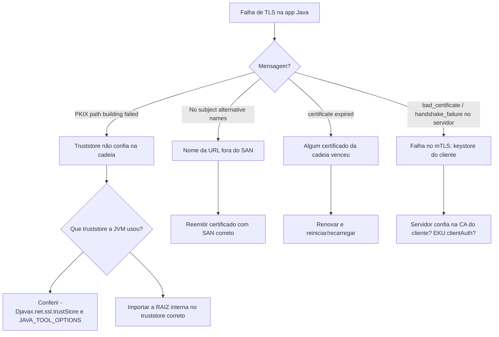

# 04 · Java: keystore, truststore e `cacerts`

**[← 03 · TLS e mTLS](03-tls-e-mtls.md) · [Sumário](../README.md) · [05 · Diagnóstico de TLS (guia de incidente) →](05-diagnostico-tls.md)**

> **Analogia:** o **keystore** é a **sua pasta pessoal**: seus documentos com selo e a sua assinatura de próprio punho (chave privada). O **truststore** é a **lista de cartórios que você aceita**. O **`cacerts`** é a lista de cartórios que **já vem de fábrica** com a JVM.

## Os três conceitos

| Conceito | Responde | Contém | Quem usa |
|---|---|---|---|
| **Keystore** | "quem sou eu?" | chave privada + certificado (+ cadeia) | servidor TLS; cliente em mTLS |
| **Truststore** | "em quem confio?" | certificados de **CAs** (ou certificados confiados diretamente) | cliente TLS; servidor em mTLS |
| **`cacerts`** | truststore **padrão** da JVM | CAs públicas conhecidas | qualquer app que não configure outro |

Tecnicamente os dois são `java.security.KeyStore`; o que muda é o **uso** (entrada com chave privada vs. entrada só com certificado).

```
        ┌───────────── JVM ─────────────┐
        │  SSLContext                   │
        │   ├─ KeyManager   ◀── keystore    "o que eu apresento"
        │   └─ TrustManager ◀── truststore  "o que eu aceito"
        └───────────────────────────────┘
```

## Qual truststore a JVM usa? (ordem)

Lido na documentação oficial do JDK/JSSE ✅/📎, e confirmado nos laboratórios:

1. Se `-Djavax.net.ssl.trustStore=<arquivo>` estiver definido, **usa esse arquivo**.
2. Senão, se existir `$JAVA_HOME/lib/security/jssecacerts`, usa-o.
3. Senão, usa `$JAVA_HOME/lib/security/cacerts` (senha padrão **`changeit`**).

> ⚠️ **Pegadinha nº 1 de incidentes:** definir `-Djavax.net.ssl.trustStore` **substitui** o `cacerts`, não soma. A aplicação passa a **não confiar** em mais nenhuma CA pública (o seu `HttpClient` para a internet quebra). O laboratório confirma isso no cenário 2/3.

Propriedades relacionadas:

```bash
-Djavax.net.ssl.trustStore=/etc/ssl/meu-truststore.p12
-Djavax.net.ssl.trustStorePassword=changeit
-Djavax.net.ssl.trustStoreType=PKCS12
-Djavax.net.ssl.keyStore=/etc/ssl/meu-keystore.p12          # só mTLS (cliente) ou servidor sem Spring
-Djavax.net.ssl.keyStorePassword=...
```

Evite colocar senhas em linha de comando (aparecem em `ps`). Prefira variáveis lidas por arquivo/Secret (cap. 10).

## Formatos de store em Java

| Tipo | Observação |
|---|---|
| **PKCS12** | padrão do `keytool` e da JVM desde o Java 9 |
| **JKS** | formato antigo, específico do Java. Ainda existe; evite em projetos novos |
| `KeychainStore` (macOS) / `Windows-ROOT` (Windows) | a JVM **não lê** o Keychain/Windows Store por padrão; é preciso pedir explicitamente |

Por isso "no meu Mac/Windows funciona no Chrome e na JVM não": o Chrome usa o repositório do sistema, a JVM usa `cacerts`.

## `keytool` essencial

```bash
# Listar o cacerts do JDK em uso (senha padrão: changeit)
keytool -list -cacerts -storepass changeit | head

# Listar um store qualquer, com detalhes
keytool -list -v -keystore servidor.p12 -storetype PKCS12 -storepass changeit

# Criar um truststore só com a raiz da CA interna
keytool -importcert -alias raiz-interna -file raiz.crt \
        -keystore truststore.p12 -storetype PKCS12 -storepass changeit -noprompt

# Adicionar uma CA ao cacerts do JDK (cuidado: altera o JDK; some em upgrade de imagem)
keytool -importcert -cacerts -alias raiz-interna -file raiz.crt -storepass changeit -noprompt

# Ver o que um servidor apresenta (sem abrir truststore)
keytool -printcert -sslserver servidor.exemplo.com:443

# Ver um arquivo de certificado
keytool -printcert -file servidor.crt

# Gerar um par de chaves + autoassinado (somente laboratório)
# ATENÇÃO: os padrões variam por versão do JDK; informe sempre algoritmo e tamanho
keytool -genkeypair -alias app -keyalg RSA -keysize 2048 -validity 90 \
        -dname "CN=localhost" -ext "SAN=dns:localhost,ip:127.0.0.1" \
        -keystore app.p12 -storetype PKCS12 -storepass changeit

# Converter JKS legado para PKCS12
keytool -importkeystore -srckeystore velho.jks -srcstoretype JKS \
        -destkeystore novo.p12 -deststoretype PKCS12
```

> Exemplo real de `keytool -list -cacerts` neste ambiente: `Keystore type: JKS ... Your keystore contains 120 entries`. O tipo e o número variam por distribuição de JDK. Isso é normal.

## Como um incidente típico "cai" no keystore/truststore



## Código: carregar stores e montar um `SSLContext`

```java
static SSLContext contexto(Path keystore, char[] senhaKs, Path truststore, char[] senhaTs) throws Exception {
    KeyManager[] km = null;
    if (keystore != null) {
        KeyStore ks = KeyStore.getInstance("PKCS12");
        try (var in = Files.newInputStream(keystore)) { ks.load(in, senhaKs); }
        var kmf = KeyManagerFactory.getInstance(KeyManagerFactory.getDefaultAlgorithm());
        kmf.init(ks, senhaKs);
        km = kmf.getKeyManagers();
    }
    TrustManager[] tm = null;                 // null => usa o truststore padrão da JVM
    if (truststore != null) {
        KeyStore ts = KeyStore.getInstance("PKCS12");
        try (var in = Files.newInputStream(truststore)) { ts.load(in, senhaTs); }
        var tmf = TrustManagerFactory.getInstance(TrustManagerFactory.getDefaultAlgorithm());
        tmf.init(ts);
        tm = tmf.getTrustManagers();
    }
    SSLContext ctx = SSLContext.getInstance("TLS");
    ctx.init(km, tm, null);
    return ctx;
}
```

Em Spring Boot você **não** precisa escrever isso: use SSL Bundles (cap. 09 e 11).

## Spring Boot: SSL Bundles (lido na doc oficial ✅)

```yaml
spring:
  ssl:
    bundle:
      jks:                     # "jks" é só o nome do grupo; serve também para arquivos PKCS12
        meu-cliente:
          keystore:
            location: "file:/etc/tls/cliente.p12"
            password: "${KS_PASS}"
            type: "PKCS12"
          truststore:
            location: "file:/etc/tls/truststore.p12"
            password: "${TS_PASS}"
            type: "PKCS12"
      pem:                     # alternativa: arquivos PEM (formato do cert-manager)
        meu-servidor:
          keystore:
            certificate: "file:/etc/tls/tls.crt"
            private-key: "file:/etc/tls/tls.key"
server:
  ssl:
    bundle: "meu-servidor"
```

## Armadilhas e "faça assim"

| Não faça | Faça |
|---|---|
| Alterar o `cacerts` dentro do contêiner em execução | Construir a imagem com o truststore correto, ou montar um truststore via Secret/ConfigMap e apontá-lo à app |
| Definir `-Djavax.net.ssl.trustStore` apontando só para a CA interna e esperar que a internet funcione | Criar um truststore que **contenha** as CAs públicas **e** a CA interna, ou usar bundles por cliente (só para o destino que precisa) |
| Compartilhar a senha `changeit` como "segredo" | Entenda que `changeit` é só o padrão do `cacerts`; a senha de trust stores não protege confidencialidade (só integridade). Já a senha de **keystore com chave privada** é segredo de verdade |
| Distribuir `.jks` por e-mail | Distribuir via cofre/Secret; preferir PEM/PKCS12 gerados por automação |
| Gerar keystore com `keytool` sem `-keyalg`/`-keysize` | Informar sempre; os padrões mudam por versão |

## Fontes

- ✅ `keytool` — documentação oficial do JDK (ver [14](14-referencias.md))
- ✅ Spring Boot Reference: *SSL* (SSL Bundles, PEM, JKS)
- 📎 JSSE Reference Guide (ordem de truststore, propriedades `javax.net.ssl.*`)
- ✅ Execução real: [`labs/tls-java`](../labs/tls-java/)

**[← 03 · TLS e mTLS](03-tls-e-mtls.md) · [Sumário](../README.md) · [05 · Diagnóstico de TLS (guia de incidente) →](05-diagnostico-tls.md)**
