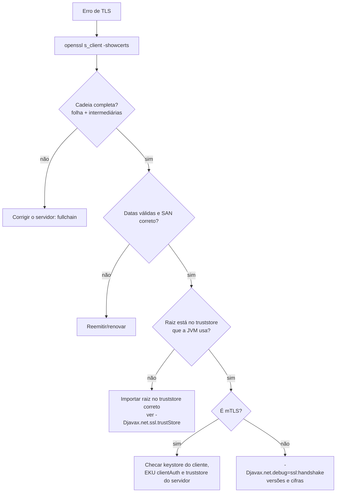

# 05 · Diagnóstico de TLS (guia de incidente)

**[← 04 · Java: keystore, truststore e `cacerts`](04-java-keystore-truststore.md) · [Sumário](../README.md) · [06 · JWT: o documento assinado que viaja →](06-jwt.md)**

> **Analogia:** o banco recusou o documento. Antes de brigar com o Fulano, pergunte: o selo está no prazo? O nome é o certo? O cartório está na lista do banco? O documento veio completo (com a folha do cartório)?

## O roteiro de cinco comandos

```bash
# 1. O que o servidor realmente apresenta? (cadeia, prazos, SAN)
openssl s_client -connect api.exemplo.com:443 -servername api.exemplo.com -showcerts </dev/null

# 2. Prazo e nomes do certificado folha
echo | openssl s_client -connect api.exemplo.com:443 -servername api.exemplo.com 2>/dev/null \
  | openssl x509 -noout -subject -issuer -dates -ext subjectAltName

# 3. Visão do Java sobre o mesmo servidor (sem depender de truststore)
keytool -printcert -sslserver api.exemplo.com:443

# 4. Este certificado fecha a cadeia com a minha raiz?
openssl verify -CAfile raiz.crt -untrusted inter.crt servidor.crt

# 5. O que a JVM vai tentar usar? (qual truststore, quais opções)
jcmd <pid> VM.system_properties | grep -E "javax.net.ssl|java.home"
# ou, para a linha de comando completa do processo:
ps -o args= -p <pid>
```

> `-servername` é o **SNI**: sem ele, servidores que hospedam vários nomes podem entregar o certificado errado.

No laboratório, o passo 1 revela o problema do cenário 5 (intermediária ausente):

```text
 0 s:CN = localhost
   i:CN = Cartorio Intermediario (lab)
 1 s:CN = Cartorio Intermediario (lab)
   i:CN = Cartorio Raiz (lab)
Verification error: unable to get local issuer certificate
Verify return code: 20 (unable to get local issuer certificate)
```

(O `Verify return code: 20` aqui aparece porque o `openssl` não recebeu a raiz no seu próprio truststore, o que é esperado em laboratório.)

## Ligando o log do handshake na JVM

```bash
java -Djavax.net.debug=ssl:handshake -jar app.jar          # handshake
java -Djavax.net.debug=ssl:handshake:verbose -jar app.jar   # mais ruidoso
java -Djavax.net.debug=all -jar app.jar                     # tudo (muito grande)
```

Em Kubernetes, sem reconstruir imagem:

```bash
kubectl set env deployment/pedidos JAVA_TOOL_OPTIONS="-Djavax.net.debug=ssl:handshake"
# Reverter depois! O log pode conter informações sensíveis e é volumoso.
kubectl set env deployment/pedidos JAVA_TOOL_OPTIONS-
```

## Tabela de sintomas

| Mensagem (cliente Java) | Significa | Onde olhar | Solução |
|---|---|---|---|
| `PKIX path building failed: ... unable to find valid certification path to requested target` | Nenhuma raiz da cadeia no truststore **ou** cadeia incompleta | passos 1 e 5; qual truststore a JVM usa | Importar a **raiz** correta; corrigir o servidor para enviar intermediárias |
| `No subject alternative names matching IP address X found` / `No name matching X found` | O nome/IP acessado não está no SAN | passo 2 | Reemitir com SAN correto, ou usar o nome certo na URL |
| `certificate expired` / `NotAfter` | Algum certificado da cadeia venceu | passo 2 | Renovar; automatizar (cert-manager) |
| `(certificate_unknown)` no `SSLHandshakeException` | Resumo genérico do alerta TLS | combinar com as linhas seguintes da exceção | seguir a causa específica |
| `Received fatal alert: handshake_failure` | Não houve acordo de protocolo/cifra | `-Djavax.net.debug=ssl:handshake`; versões TLS | Alinhar versões/cifras; atualizar o lado legado |
| `bad_certificate` / `certificate_required` (visto no servidor) ou `header parser received no bytes` (cliente) | **mTLS**: o cliente não enviou certificado aceito | log do servidor; keystore do cliente | Configurar keystore do cliente; servidor deve confiar na CA que emitiu o certificado do cliente; EKU `clientAuth` |
| `unable to find valid certification path` **só em um ambiente** | Truststores diferentes entre ambientes | comparar `JAVA_TOOL_OPTIONS`, imagem base e volumes | Padronizar via imagem/Secret |
| Funciona no browser, falha na JVM | Servidor não envia a intermediária (browser completa; JVM não) ou JVM não vê o repositório do sistema | passo 1 | Corrigir o `fullchain` |
| `Connection reset` logo após o ClientHello | Proxy/WAF/Firewall interrompendo; SNI/ALPN | rede e proxy | Verificar proxy corporativo (inspeção TLS usa uma CA própria que precisa estar no truststore) |

> **Inspeção TLS corporativa** (proxy que "abre" o HTTPS): o certificado que a JVM recebe é emitido por uma CA da empresa. Ela precisa estar no truststore. Esse é o motivo número 1 de `PKIX` ao acessar a internet a partir da rede corporativa.

## Fluxo de decisão



## Armadilhas e "faça assim"

| Não faça | Faça |
|---|---|
| "Deu PKIX, vou desligar a validação" | Descubra **qual** das 4 causas é (cadeia, nome, prazo, raiz) e corrija essa |
| Importar o certificado **folha** do servidor no truststore para "resolver" | Importar a **raiz** (ou intermediária) da CA; a folha muda a cada renovação |
| Reiniciar tudo esperando melhorar | Capturar `openssl s_client` e o log do handshake **antes** de mexer, para ter evidência |
| Deixar `javax.net.debug` ligado | Desligar após o incidente (volume de logs e dados sensíveis) |

## Fontes

- ✅ Execução real: [`labs/tls-java/cenarios.sh`](../labs/tls-java/cenarios.sh)
- 📎 JSSE Reference Guide — *Debugging Utilities* (`javax.net.debug`)
- 📎 RFC 8446 §6 (alertas TLS)
- ✅ `keytool -printcert -sslserver` (documentação oficial do keytool)

**[← 04 · Java: keystore, truststore e `cacerts`](04-java-keystore-truststore.md) · [Sumário](../README.md) · [06 · JWT: o documento assinado que viaja →](06-jwt.md)**
