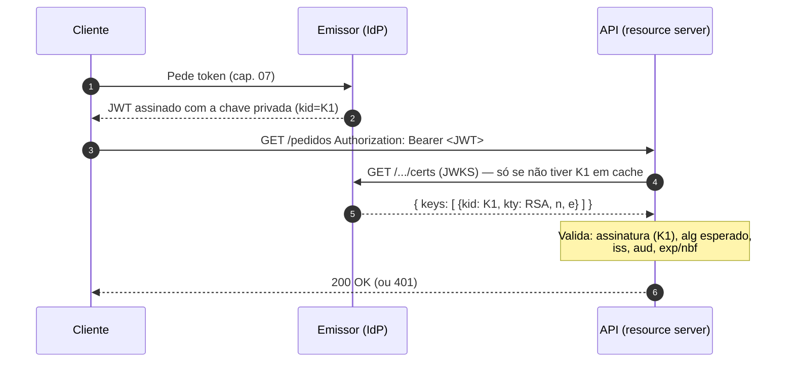

# 06 · JWT: o documento assinado que viaja

**[← 05 · Diagnóstico de TLS (guia de incidente)](05-diagnostico-tls.md) · [Sumário](../README.md) · [07 · OAuth 2.0 e OpenID Connect →](07-oauth2-oidc.md)**

> **Analogia:** o JWT é **um crachá com selo holográfico**. Qualquer um **lê** o que está impresso (nome, setor, validade), mas só o emissor consegue fabricar o selo. O porteiro (sua API) não liga para o RH a cada visita: ele confere o selo com a **chave pública** do emissor. **Crachá não é cofre:** o que está impresso é visível.

## Anatomia

```
 eyJhbGciOiJSUzI1NiIs....   .   eyJpc3MiOiJodHRwczovL...   .   ZFQzkHRDpzfG5t7Lt2m...
 └──── HEADER ────────┘          └───── PAYLOAD (claims) ──┘      └──── SIGNATURE ─────┘
   {"alg":"RS256",                {"iss":"https://idp/...",         assinatura sobre
    "typ":"JWT",                   "sub":"u-123",                   BASE64URL(header) + "." + BASE64URL(payload)
    "kid":"chave-2026-11"}         "aud":"api-pedidos",
                                   "scope":"pedidos:ler",
                                   "iat":..., "exp":...}
```

- Cada parte é **Base64URL** (sem `=`), separadas por ponto (RFC 7519 📎, RFC 7515 📎).
- Header e payload **não são secretos**. Não coloque senha, CPF completo ou dado sensível no payload.
- O que dá confiança é a **assinatura**.

### Claims registrados que você precisa saber

| Claim | Significado | A API deve... |
|---|---|---|
| `iss` | quem emitiu | conferir que é o emissor **esperado** |
| `sub` | de quem é (usuário/cliente) | usar como identificador |
| `aud` | para quem se destina | conferir que **inclui esta API** |
| `exp` | expira | rejeitar se passou (com pequena tolerância de relógio) |
| `nbf` | não vale antes de | rejeitar se ainda não chegou |
| `iat` | emitido em | informativo |
| `jti` | id único | útil para revogação/anti-replay |
| `scope` / `scp` | permissões OAuth | mapear para autoridades |

## JWS vs JWE

- **JWS (assinado)** é o JWT comum: integridade e autoria, **sem sigilo**.
- **JWE (cifrado)** esconde o conteúdo. É raro em APIs internas; na maioria dos casos TLS já resolve o sigilo em trânsito.

## Algoritmos

| Algoritmo | Tipo | Quem valida precisa de... | Observação |
|---|---|---|---|
| **RS256** | RSA assinatura | **chave pública** | o padrão de mercado em OIDC; permite publicar JWKS |
| ES256 | ECDSA | chave pública | menor, mais rápido |
| **HS256** | HMAC | o **mesmo segredo** do emissor | só quando emissor e validador são o mesmo sistema |
| `none` | sem assinatura | — | **nunca aceitar** |

> **Regra de ouro (RFC 8725 📎):** o **algoritmo aceito é definido na configuração do servidor**, nunca pelo campo `alg` que vem dentro do token. Foi assim que nasceram ataques "troque RS256 por HS256 usando a chave pública como segredo" e "alg=none".

## JWKS: como a API descobre a chave pública

O emissor publica um conjunto de chaves públicas (JWK Set, RFC 7517 📎). O token indica qual com `kid`.



Isso é **rotação de chaves sem deploy**: o IdP publica uma nova chave (novo `kid`), a API baixa e guarda em cache.

## Prática 1 — montar e validar um JWT só com `openssl`

[`labs/jwt-bash/jwt-bash.sh`](../labs/jwt-bash/jwt-bash.sh):

```bash
b64url() { openssl base64 -A | tr '+/' '-_' | tr -d '='; }

H=$(printf '%s' "$HEADER"  | b64url)
P=$(printf '%s' "$PAYLOAD" | b64url)
S=$(printf '%s' "$H.$P" | openssl dgst -sha256 -sign priv.pem | b64url)
JWT="$H.$P.$S"

# Validar
printf '%s' "$H.$P" | openssl dgst -sha256 -verify pub.pem -signature sig.bin
```

Saída real:

```text
== Corpo decodificado (qualquer um lê)
{"iss":"https://idp.exemplo.com/realms/loja","sub":"u-123","aud":"api-pedidos","scope":"pedidos:ler",...}

== Validando a assinatura com a chave pública
Verified OK

== Adulterando o corpo (escopo vira pedidos:apagar)
...bad signature
Verification failure
```

Decodificar um JWT de qualquer origem (somente para **ler**, não para validar):

```bash
TOKEN="eyJ...."
echo "$TOKEN" | cut -d. -f2 | tr '_-' '/+' | base64 -d 2>/dev/null; echo
# alguns tokens precisam de padding "=": se der erro, use:  | sed -E 's/$/====/' | base64 -d 2>/dev/null
```

> Nunca cole tokens **reais de produção** em sites de terceiros para "decodificar". Use o terminal.

## Prática 2 — validar em Java com o JDK

[`labs/jwt-java/JwtNaMao.java`](../labs/jwt-java/JwtNaMao.java) valida na ordem certa: **algoritmo → assinatura → iss → aud → exp**.

```java
static final String ALGORITMO_ACEITO = "RS256";     // vem da CONFIGURAÇÃO, não do token

static void validar(String jwt, PublicKey chave, String issEsperado, String audEsperada) throws Exception {
    String[] p = jwt.split("\\.");
    String header = new String(Base64.getUrlDecoder().decode(p[0]), UTF_8);
    if (!ALGORITMO_ACEITO.equals(texto(header, "alg")))
        throw new SecurityException("algoritmo não aceito");        // barra alg=none e troca de algoritmo

    Signature sig = Signature.getInstance("SHA256withRSA");
    sig.initVerify(chave);
    sig.update((p[0] + "." + p[1]).getBytes(US_ASCII));
    if (!sig.verify(Base64.getUrlDecoder().decode(p[2])))
        throw new SecurityException("assinatura não confere");
    // depois: iss, aud, exp/nbf
}
```

Saída real:

```text
token íntegro      -> OK (assinatura, iss, aud e exp conferem)
escopo adulterado  -> RECUSADO: assinatura não confere
alg=none           -> RECUSADO: algoritmo 'none' não é aceito
token expirado     -> RECUSADO: token expirado
```

E o JWK que o emissor publicaria:

```json
{"kty":"RSA","use":"sig","alg":"RS256","kid":"chave-2026-11","n":"oZLMzCN8...","e":"AQAB"}
```

> **Isto é um laboratório.** Extrair JSON com regex, como o laboratório faz, não deve ser feito em produção. Use Spring Security / Nimbus (cap. 09).

## Armadilhas e "faça assim"

| Não faça | Faça |
|---|---|
| Confiar no `alg` do header | Fixar o algoritmo aceito na configuração |
| Aceitar token sem checar `iss` e `aud` | Validar sempre os dois. Sem `aud`, um token emitido para **outra** API passa na sua |
| Guardar dados sensíveis no payload | Colocar apenas identificadores e permissões; buscar o resto por API |
| Tokens de vida longa (horas/dias) | Access token curto (minutos) + refresh token no cliente confidencial |
| Usar HS256 entre sistemas diferentes | Usar RS256/ES256 com JWKS: quem valida **não** consegue forjar |
| Guardar JWT em `localStorage` de SPA sem pensar em XSS | Preferir padrão BFF/cookie `HttpOnly` para navegador (ver RFC 9700 e OAuth 2.0 for Browser-Based Apps 📎) |
| Revogar "apagando" o JWT | JWT é *stateless*: use expiração curta, `jti`+lista de revogação, ou introspecção (cap. 07) |

## Fontes

- 📎 RFC 7519 (JWT) · RFC 7515 (JWS) · RFC 7517 (JWK) · RFC 7518 (JWA) · **RFC 8725 (JWT Best Current Practices)**
- ✅ Spring Security Reference: *OAuth 2.0 Resource Server — JWT* (ver cap. 09)
- ✅ Execução real: [`labs/jwt-bash`](../labs/jwt-bash/), [`labs/jwt-java`](../labs/jwt-java/)

**[← 05 · Diagnóstico de TLS (guia de incidente)](05-diagnostico-tls.md) · [Sumário](../README.md) · [07 · OAuth 2.0 e OpenID Connect →](07-oauth2-oidc.md)**
