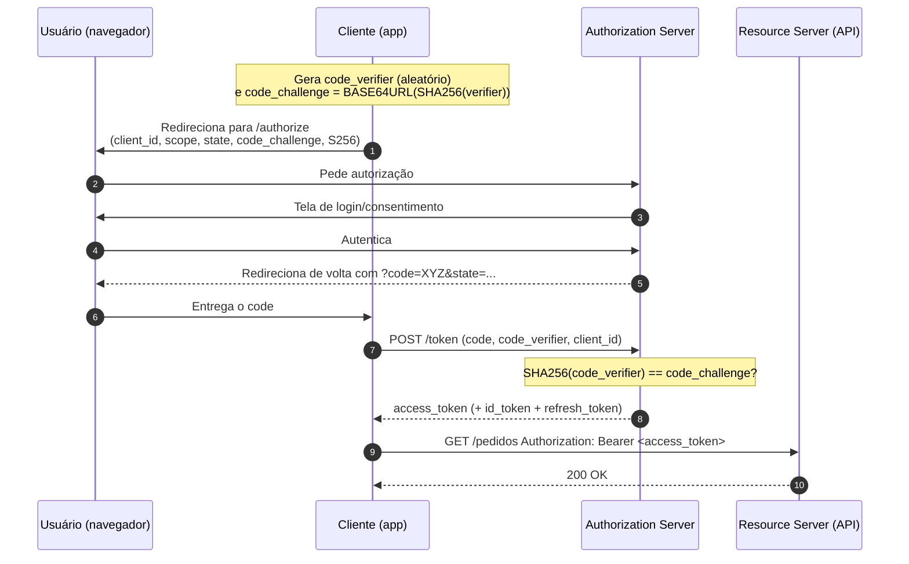
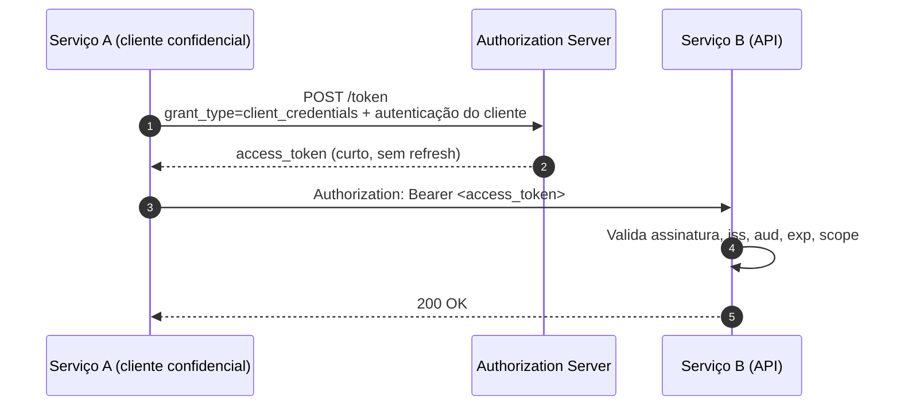

# 07 · OAuth 2.0 e OpenID Connect

**[← 06 · JWT: o documento assinado que viaja](06-jwt.md) · [Sumário](../README.md) · [08 · Keycloak e RH-SSO →](08-keycloak-rhsso.md)**

> **Analogia:** você vai a um prédio comercial. Na recepção (**servidor de autorização**) você se identifica e diz a quais andares quer ir; ela emite um **crachá temporário** (access token) limitado a esses andares (**scopes**). O segurança de cada andar (**API / resource server**) só olha o crachá. **OAuth 2.0 é sobre autorização** (o que o crachá permite). **OpenID Connect (OIDC)** acrescenta **identidade**: um documento (ID token) dizendo **quem** fez login.

## Os quatro papéis

| Papel | Quem é | Exemplo |
|---|---|---|
| **Resource Owner** | o dono dos dados (usuário) | cliente do banco |
| **Client** | a aplicação que quer acessar | app web, BFF, outro microserviço |
| **Authorization Server (AS / IdP)** | emite tokens | Keycloak / RH-SSO |
| **Resource Server (RS)** | a API protegida | `api-pedidos` |

## Qual fluxo (grant) usar?

| Situação | Fluxo | Observação |
|---|---|---|
| Usuário humano em app web/mobile | **Authorization Code + PKCE** | padrão atual para qualquer cliente (RFC 7636 📎, RFC 9700 📎) |
| Serviço chamando serviço, sem usuário | **Client Credentials** | cliente **confidencial** com segredo ou certificado |
| Renovar sem pedir login de novo | **Refresh Token** | guardar só em cliente confiável |
| Trocar um token por outro (outro `aud`, impersonação controlada) | **Token Exchange** (RFC 8693 📎) | depende do suporte do IdP |
| ~~Implicit~~, ~~Password (ROPC)~~ | **não usar** | removidos/desencorajados pela BCP de segurança (RFC 9700 📎) |

## Authorization Code + PKCE (usuário humano)



**Por que PKCE?** Se alguém roubar o `code` no redirecionamento, **não consegue trocá-lo** sem o `code_verifier`, que só o cliente original conhece.

Gerar um par verifier/challenge no terminal:

```bash
verifier=$(openssl rand -base64 48 | tr '+/' '-_' | tr -d '=\n')
challenge=$(printf '%s' "$verifier" | openssl dgst -sha256 -binary | openssl base64 -A | tr '+/' '-_' | tr -d '=')
echo "verifier=$verifier"
echo "challenge=$challenge"
```

## Client Credentials (serviço → serviço)



```bash
# Exemplo genérico (ajuste URL, client_id e segredo; o segredo vem de variável, não de histórico de shell)
curl -sS -X POST "$TOKEN_URL" \
  -u "$CLIENT_ID:$CLIENT_SECRET" \
  -d grant_type=client_credentials \
  -d scope=pedidos:ler
```

> `-u` coloca o segredo na linha de comando (visível em `ps` e histórico). Em automações use arquivo protegido ou `--data-urlencode` lendo de variável de ambiente injetada por Secret.

## OIDC: o que muda

| | OAuth 2.0 | OpenID Connect |
|---|---|---|
| Pergunta | "o que este token **permite**?" | "**quem** acabou de autenticar?" |
| Token principal | access token | **ID token** (um JWT) + access token |
| Scope especial | — | `openid` (obrigatório), `profile`, `email` |
| Destinatário | a **API** (RS) | o **cliente** (a aplicação) |
| Descoberta | opcional (RFC 8414) | `/.well-known/openid-configuration` |

> **Regra prática:** o **ID token é para o cliente**; **nunca o envie como Bearer para uma API**. A API recebe o **access token**.

### Documento de descoberta

O IdP publica um JSON com os endpoints (`issuer`, `authorization_endpoint`, `token_endpoint`, `jwks_uri`, ...). Spring Security o usa quando você configura só o `issuer-uri` (✅ lido na doc: o `issuer-uri` exige que o endpoint de configuração do emissor exista).

```bash
curl -s "$ISSUER/.well-known/openid-configuration" | jq '{issuer, token_endpoint, jwks_uri}'
```

## Access token: JWT ou opaco?

| | JWT (auto-contido) | Opaco |
|---|---|---|
| Como a API valida | localmente (assinatura + claims) | **introspecção** no AS (RFC 7662 📎) |
| Latência | baixa | uma chamada ao AS (cache ajuda) |
| Revogação imediata | difícil | simples |
| Spring Security | `oauth2ResourceServer().jwt()` | `.opaqueToken()` ✅ |

## Boas práticas de mercado (resumo da BCP, RFC 9700 📎)

- Use **Authorization Code + PKCE** até para clientes confidenciais.
- **redirect_uri** registrado com **correspondência exata**.
- Use o parâmetro **`state`** (ou PKCE) contra CSRF.
- Tokens de curta duração; **refresh tokens** com rotação ou vinculados ao cliente.
- **Menor privilégio**: peça apenas os scopes necessários; use **audience** restrita.
- Nunca em URL de query: tokens em `Authorization: Bearer`.

## Armadilhas e "faça assim"

| Não faça | Faça |
|---|---|
| Usar ID token como credencial de API | Access token com `aud` da API |
| Usar o mesmo `client_id` e segredo em todos os serviços | Um client por serviço, com scopes mínimos |
| Segredo de cliente no repositório | Segredo no cofre/Secret (cap. 10) ou autenticação por certificado/`private_key_jwt` |
| Fluxo Password (usuário e senha direto no app) | Authorization Code + PKCE |
| Access token com validade longa para "evitar renovar" | Curto + refresh/renovação automática no cliente (ver `OAuth2AuthorizedClientManager`, cap. 09) |

## Fontes

- 📎 RFC 6749 (OAuth 2.0) · RFC 7636 (PKCE) · **RFC 9700 (OAuth 2.0 Security BCP)** · RFC 7662 (introspecção) · RFC 8693 (token exchange) · RFC 8414 (metadados do AS)
- 📎 OpenID Connect Core 1.0 · OpenID Connect Discovery 1.0 (openid.net)
- ✅ Spring Security Reference: *Resource Server (JWT / Opaque Token)* e *OAuth2 Client*

**[← 06 · JWT: o documento assinado que viaja](06-jwt.md) · [Sumário](../README.md) · [08 · Keycloak e RH-SSO →](08-keycloak-rhsso.md)**
