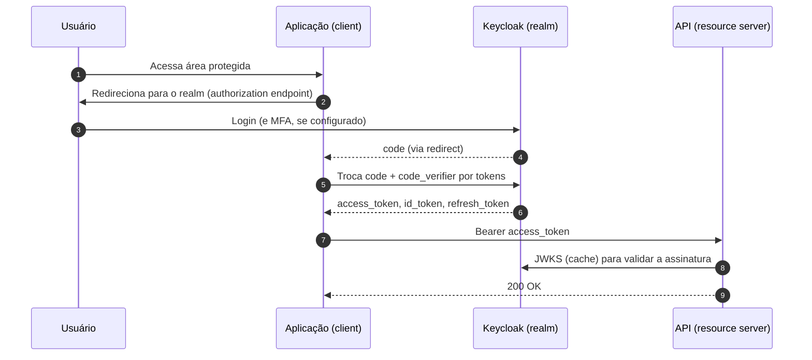

# 08 · Keycloak e RH-SSO

**[← 07 · OAuth 2.0 e OpenID Connect](07-oauth2-oidc.md) · [Sumário](../README.md) · [09 · Spring Security: API que valida tokens →](09-spring-security.md)**

> **Analogia:** o Keycloak é **a recepção do prédio**: cadastra pessoas e empresas (usuários e clients), confere identidade, emite crachás (tokens) e publica o modelo do selo (JWKS) para os seguranças de cada andar (APIs) conferirem.

> ⚠️ **Aviso de verificação.** Durante a escrita deste livro as páginas oficiais do Keycloak e da Red Hat **não puderam ser abertas** (acesso bloqueado no ambiente de autoria). Este capítulo, portanto, se limita a conceitos amplamente documentados do Keycloak e **sempre oferece um comando para você confirmar no seu servidor**. Nomes de menus, caminhos com `/auth` e relação RH-SSO ↔ Keycloak devem ser conferidos na documentação da **versão que sua empresa opera**. Isto é um ponto a validar antes de ensinar.

## O que é cada coisa

- **Keycloak**: servidor open source de identidade (IdP) que fala **OIDC**, **OAuth 2.0** e **SAML 2.0**.
- **RH-SSO / Red Hat build of Keycloak**: produtos da Red Hat baseados no Keycloak ⚠️ (nomes e versões variam; confirme qual a sua organização usa).

## Vocabulário essencial

| Termo | Significado | Analogia |
|---|---|---|
| **Realm** | espaço isolado de usuários, clients e configurações | um prédio com seu próprio cadastro |
| **Client** | aplicação/serviço que usa o realm (`client_id`) | uma empresa que opera no prédio |
| **User** | pessoa autenticada | visitante/funcionário |
| **Role** | papel (realm role ou client role) | cargo no crachá |
| **Group** | conjunto de usuários que herda roles | departamento |
| **Client scope / Mapper** | decide **quais claims** entram no token | o que é impresso no crachá |
| **Service account** | usuário técnico de um client (Client Credentials) | crachá de máquina |

## Tipo de client

| Tipo | Quando | Autentica-se como |
|---|---|---|
| **Confidencial** (`client authentication` ligado) | backend, BFF, serviço | segredo ou certificado/`private_key_jwt` |
| **Público** | SPA/mobile (não guarda segredo) | só `client_id` + **PKCE** |
| **Bearer-only / apenas RS** (APIs que só validam tokens) | resource server | não precisa pedir token; só valida |

> A nomenclatura exata dos botões muda entre versões (ex.: "Access Type" em versões antigas, "Client authentication" em versões novas) ⚠️.

## Endpoints: como descobrir sem decorar

Pelo documento de descoberta, **sempre**:

```bash
# O formato do caminho depende da versão/configuração (ex.: com ou sem prefixo /auth) ⚠️
ISSUER="https://sso.suaempresa.com/realms/meu-realm"
curl -s "$ISSUER/.well-known/openid-configuration" | jq '{issuer, authorization_endpoint, token_endpoint, jwks_uri, introspection_endpoint}'
```

O que você deve esperar na resposta (campos definidos pelo OIDC Discovery 📎): `issuer`, `authorization_endpoint`, `token_endpoint`, `jwks_uri`, entre outros. **Copie os valores dessa resposta**; não monte URLs de cabeça.

## Obter um token (Client Credentials)

```bash
TOKEN_URL=$(curl -s "$ISSUER/.well-known/openid-configuration" | jq -r .token_endpoint)

curl -sS -X POST "$TOKEN_URL" \
  -d grant_type=client_credentials \
  -d client_id="$CLIENT_ID" \
  --data-urlencode client_secret="$CLIENT_SECRET" | jq -r '.access_token' > token.txt

# Ler o corpo do token (só para inspecionar)
cut -d. -f2 < token.txt | tr '_-' '/+' | base64 -d 2>/dev/null | jq .
```

O que conferir no resultado: `iss` igual ao issuer do Spring, `aud` contendo sua API, `exp` curto, e onde estão as roles.

## Onde estão as roles no token?

Convenção **comumente observada** em tokens do Keycloak ⚠️ (confirme inspecionando um token real do seu realm):

```json
{
  "realm_access":   { "roles": ["operador"] },
  "resource_access": { "api-pedidos": { "roles": ["pedidos-leitura"] } },
  "scope": "openid profile email"
}
```

O Spring Security **não** lê essas estruturas por padrão (✅ lido na doc oficial: por padrão ele mapeia só `scope`/`scp` para `SCOPE_...`). Você precisa de um conversor (cap. 09).

## Fluxo de login web com Keycloak



## Rotação de chaves do realm

O Keycloak mantém chaves de assinatura do realm e as publica no JWKS. Quando há rotação, tokens novos usam um novo `kid`; a API deve ter **cache com refresh por `kid` desconhecido** (as bibliotecas Spring/Nimbus lidam com isso). Se a sua API validar com **chave fixa colada em arquivo**, a rotação vai derrubá-la, por isso use `issuer-uri`/`jwk-set-uri` (cap. 09).

## Diagnóstico: "401 na API" quando o login funciona

| Sintoma | Causa comum | Como conferir |
|---|---|---|
| 401 com `invalid_token` / "iss claim is not valid" | `issuer` configurado ≠ `iss` do token (URL interna vs pública, `http` vs `https`, `/auth`) | comparar o `iss` do token com `issuer-uri` |
| 401 "aud" | token sem a audiência da API | decodificar o token; configurar mapper de audience no client ⚠️ |
| 403 apesar de a role existir | a role está em `realm_access`/`resource_access` e a API só lê `scope` | conversor de authorities (cap. 09) |
| 401 depois de horas | token expirou e o cliente não renova | `exp`; usar `OAuth2AuthorizedClientManager` |
| Falha ao baixar JWKS | truststore da API não confia no certificado do Keycloak | cap. 05 (PKIX) |

> O último item mostra por que este livro junta **TLS e tokens**: o `jwk-set-uri` é uma chamada HTTPS, e a API precisa **confiar na CA** do Keycloak.

## Armadilhas e "faça assim"

| Não faça | Faça |
|---|---|
| Dar `realm-admin` para serviços | Service account com roles mínimas |
| Reaproveitar um client para todas as apps | Um client por aplicação |
| Deixar `redirect_uris` como `*` | URIs exatas |
| Validar token chamando o Keycloak a cada request | Validar localmente com JWKS (JWT), ou introspecção com cache |
| Montar URLs de endpoint de memória | Ler do `.well-known/openid-configuration` |

## Fontes

- ⚠️ Keycloak Documentation (keycloak.org/documentation) — **não aberta durante a escrita**; confira a versão da sua empresa.
- ⚠️ Red Hat Single Sign-On / Red Hat build of Keycloak — documentação em docs.redhat.com, **não aberta durante a escrita**.
- 📎 OpenID Connect Discovery 1.0 · RFC 6749 · RFC 7662

**[← 07 · OAuth 2.0 e OpenID Connect](07-oauth2-oidc.md) · [Sumário](../README.md) · [09 · Spring Security: API que valida tokens →](09-spring-security.md)**
