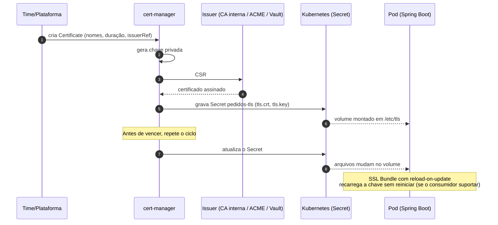

# 10 · Segredos, chaves e cofres

**[← 09 · Spring Security: API que valida tokens](09-spring-security.md) · [Sumário](../README.md) · [11 · Spring Boot no Kubernetes com certificados →](11-spring-boot-kubernetes.md)**

> **Analogia:** o **cofre do cartório**. O livro de selos e o carimbo oficial não ficam na mesa do atendente; ficam em um cofre com controle de acesso e registro de quem abriu. O atendente (a aplicação) recebe só o que precisa, na hora, e devolve.

## O que é segredo (e o que não é)

| Item | Segredo? | Onde pode ficar |
|---|---|---|
| Certificado público, cadeia, raiz da CA | **não** | ConfigMap, imagem, Git (ok) |
| **Chave privada** (`.key`, dentro de `.p12`/`.jks`) | **SIM** | cofre/Secret, nunca no Git/imagem |
| Senha do keystore (com chave privada) | **SIM** | cofre/Secret |
| Senha do truststore | não protege confidencialidade, mas trate como config sensível | Secret ou ConfigMap |
| `client_secret` OAuth | **SIM** | cofre/Secret |
| Access token | **SIM** (curto) | só em memória |
| Refresh token | **SIM** (forte) | só no cliente confidencial |

## Onde cada coisa deve viver

```
              Quem é o DONO do ciclo de vida?
                         │
        ┌────────────────┼──────────────────────┐
        ▼                ▼                      ▼
   A PLATAFORMA     O COFRE                 A APLICAÇÃO
 (cert-manager,     (Vault, AWS/Azure/GCP    só LÊ do disco/ambiente
  service mesh)      Secrets Manager, etc.)  e recarrega

 emite e renova    guarda, audita,           não gera, não renova,
 certificados      controla acesso           não guarda no código
```

**Princípio:** a aplicação **consome**; a plataforma **emite e renova**; o cofre **guarda e audita**.

## Kubernetes `Secret`: o que é e o que não é (✅ doc oficial)

- Um `Secret` guarda dados sensíveis, mas **por padrão é armazenado sem criptografia no etcd** (apenas codificado em Base64). Base64 **não é criptografia**.
- Para proteger: habilitar **encryption at rest** no API server, restringir acesso por **RBAC** e, idealmente, integrar com um cofre externo.
- Secret montado como **volume** é atualizado nos pods, **exceto** quando montado com `subPath` (✅ doc).

```bash
kubectl create secret tls pedidos-tls --cert=tls.crt --key=tls.key
kubectl get secret pedidos-tls -o jsonpath='{.data.tls\.crt}' | base64 -d | openssl x509 -noout -subject -dates
```

## Quatro formas de entregar o segredo à aplicação

| Forma | Como | Prós | Contras |
|---|---|---|---|
| **Variável de ambiente** | `env.valueFrom.secretKeyRef` | simples | vaza em dump de processo/`describe`; **não atualiza** sem reiniciar |
| **Volume (arquivo)** | `volumeMounts` com Secret | atualiza (sem `subPath`); combina com **SSL Bundles** e `reload-on-update` | o app precisa saber recarregar |
| **Secret sincronizado de cofre** (External Secrets Operator) | operador cria `Secret` a partir do cofre | cofre é a fonte da verdade | o valor passa a existir também como `Secret` no cluster |
| **CSI Secrets Store / agente** | volume efêmero montado direto do cofre | pode evitar `Secret` persistido | mais componentes para operar |

> **Padrão de mercado resumido:** **certificados** via **cert-manager** (emissão/renovação automática, entregue em `Secret` TLS); **segredos de aplicação** (senhas, client secrets) via **cofre** sincronizado ou montado; a app lê **arquivos**.

## cert-manager: o "cartório automático" ✅

O cert-manager observa um objeto `Certificate`, pede o certificado a um `Issuer`/`ClusterIssuer` (CA interna, ACME, Vault...) e grava o resultado num `Secret`, **renovando** antes do vencimento.

```yaml
apiVersion: cert-manager.io/v1
kind: Certificate
metadata:
  name: pedidos-tls
spec:
  secretName: pedidos-tls            # onde o par cert/chave será gravado
  duration: 2160h                    # 90 dias
  renewBefore: 720h                  # renova 30 dias antes (veja nota)
  privateKey:
    algorithm: RSA
    size: 2048
    rotationPolicy: Always           # nova chave a cada renovação (padrão Always desde a v1.18.0 ✅)
  dnsNames:
    - pedidos.prod.svc.cluster.local
    - pedidos.exemplo.com
  usages: [server auth, client auth]
  issuerRef:
    name: ca-interna
    kind: ClusterIssuer
```

Notas ✅ da documentação:

- A doc recomenda `renewBeforePercentage` (proporcional à duração) em vez de um valor fixo em `renewBefore`; use um **ou** outro. ⚠️ confirme na sua versão qual campo existe antes de copiar.
- Para gerar também **PKCS12/JKS** (app Java antiga), use `spec.keystores.pkcs12` com `passwordSecretRef` (a senha vem de **outro** Secret).

### Fluxo



## Distribuir a CA (truststore) para todos os pods ✅

Problema real: todo pod Java precisa confiar na **raiz interna**. O **trust-manager** (projeto cert-manager) publica um **Bundle** como `ConfigMap`/`Secret` em todos os namespaces, e os pods o montam:

```yaml
apiVersion: trust.cert-manager.io/v1alpha1
kind: Bundle
metadata:
  name: ca-corporativa
spec:
  sources:
    - useDefaultCAs: true            # CAs públicas
    - secret: { name: raiz-interna, key: ca.crt }
  target:
    configMap: { key: ca-bundle.crt }
```

⚠️ Lido na doc: `apiVersion trust.cert-manager.io/v1alpha1`, `useDefaultCAs: true` e `target.configMap` (o Bundle gera um ConfigMap em todos os namespaces). A fonte `secret:` do exemplo acima **não foi conferida**; a API pode mudar entre releases, confira a doc na sua versão.

## Spring Boot lendo segredos como arquivos (✅ `configtree`)

Cada arquivo de um diretório vira uma propriedade:

```yaml
spring:
  config:
    import: "optional:configtree:/etc/segredos/"     # /etc/segredos/db.password -> propriedade "db.password"
```

```yaml
# Pod: monta o Secret como volume
volumes:
  - name: segredos
    secret: { secretName: pedidos-segredos }
containers:
  - volumeMounts: [{ name: segredos, mountPath: /etc/segredos, readOnly: true }]
```

## Vault (HashiCorp) em poucas linhas

Cofre de segredos com **políticas**, **auditoria**, **segredos dinâmicos** (ex.: credencial de banco temporária) e **PKI própria**. Integração típica no Kubernetes: a app (ou um agente/operador) autentica-se com o **ServiceAccount token** do pod e recebe só os segredos que a política permite ✅ (documentação oficial do Vault e do External Secrets Operator).

## Armadilhas e "faça assim"

| Não faça | Faça |
|---|---|
| Commitar `.p12`, `.jks`, `.key` ou `.env` | `.gitignore` + scanner de segredos no CI + cofre |
| Assar o keystore **dentro da imagem** | Montar do cofre/Secret; a imagem fica igual em todos os ambientes |
| Colocar chave privada em ConfigMap | `Secret` (ou CSI) com RBAC mínimo |
| Considerar `Secret` + Base64 como "criptografado" | Habilitar encryption at rest + RBAC + auditoria |
| Mesmo certificado em todos os serviços | Um certificado por serviço, curto, automatizado |
| Renovação manual com lembrete na agenda | cert-manager (ou equivalente) + **alerta de expiração** (ex.: métrica de dias para vencer) |
| Montar com `subPath` e esperar que atualize | Montar o diretório inteiro |

## Fontes

- ✅ Kubernetes: *Secrets*, *Good practices for Secrets*, *Encrypting Confidential Data at Rest*, *TLS secrets*
- ✅ cert-manager: *Certificate*, *CA Issuer*, *csi-driver*, *trust-manager*
- ✅ Spring Boot: *Externalized Configuration — Configuration Trees*
- ✅ External Secrets Operator e HashiCorp Vault (README/documentação)

**[← 09 · Spring Security: API que valida tokens](09-spring-security.md) · [Sumário](../README.md) · [11 · Spring Boot no Kubernetes com certificados →](11-spring-boot-kubernetes.md)**
