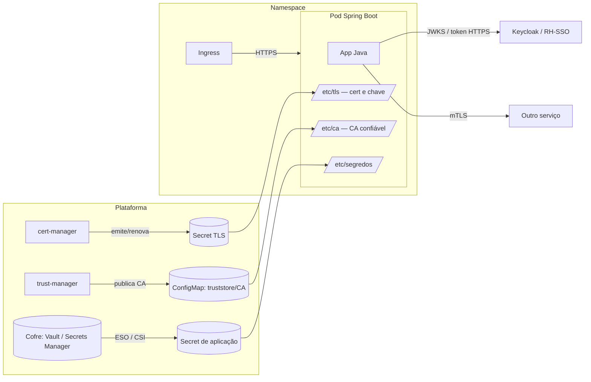
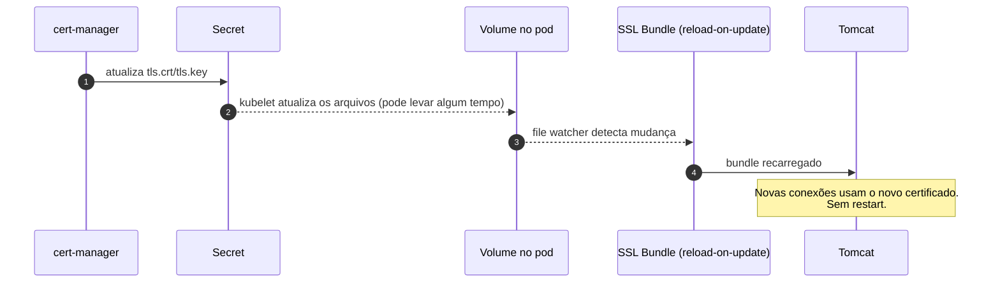

# 11 · Spring Boot no Kubernetes com certificados

**[← 10 · Segredos, chaves e cofres](10-segredos-e-cofres.md) · [Sumário](../README.md) · [12 · Runbooks, checklists e a aula de 30 minutos →](12-runbooks-checklists-aula.md)**

> **Analogia:** o prédio inteiro. A **portaria** (Ingress) atende o público com o selo do cartório; internamente, os andares (pods) se falam por **corredores** (rede do cluster). O **cartório automático** (cert-manager) emite e renova selos; o **cofre** guarda o que é secreto; cada **atendente** (app Spring) só lê o que lhe foi entregue.

## Quatro trechos de TLS em um cluster

```
 Usuário/Parceiro ──(1)──▶ Ingress/Gateway ──(2)──▶ Pod A ──(3)──▶ Pod B ──(4)──▶ Banco / IdP / API externa
     HTTPS público           termina TLS?          mTLS?            mTLS?             TLS cliente
```

| Trecho | Quem apresenta certificado | Quem valida | Onde vive a chave | Observação |
|---|---|---|---|---|
| **1. Internet → Ingress** | Ingress (cert público ou do cert-manager) | navegador/cliente | `Secret` TLS referenciado no Ingress ✅ | normalmente a plataforma cuida |
| **2. Ingress → Pod** | Pod (se re-cifrar) | Ingress (precisa confiar na CA interna) | volume/Secret do pod | decidir: terminar no Ingress **ou** cifrar até o pod |
| **3. Pod → Pod** | Pod B (e Pod A em mTLS) | quem se conecta | cada pod com seu certificado | **service mesh** faz isso sem código; sem mesh, é com bundles Spring |
| **4. Pod → externo** | servidor externo | **a JVM do pod** (truststore) | só truststore | o caso do `PKIX`: CA corporativa ausente |

### Decisão arquitetural

| Opção | Quando faz sentido | Custo |
|---|---|---|
| **TLS termina no Ingress; HTTP dentro do cluster** | rede interna confiável, requisito regulatório permite | simples; tráfego interno em claro |
| **Re-cifrar até o pod (TLS no Spring Boot)** | exigência de cifra ponta-a-ponta | certificado por pod e renovação |
| **Service mesh (mTLS automático)** | muitos serviços, política zero-trust | operar o mesh; app fica sem certificado |
| **mTLS na aplicação (SSL Bundles + cert-manager)** | sem mesh, poucos serviços | você cuida de bundles e reload |

> A escolha é da arquitetura/segurança da sua organização. O livro mostra os mecanismos; não substitui a decisão do time de plataforma.

## Arquitetura de referência



## Passo a passo (versão "sem mesh")

### 1. A plataforma emite o certificado (cap. 10)

```yaml
apiVersion: cert-manager.io/v1
kind: Certificate
metadata: { name: pedidos-tls }
spec:
  secretName: pedidos-tls
  duration: 2160h
  dnsNames: [pedidos, pedidos.prod.svc, pedidos.prod.svc.cluster.local]
  usages: [server auth, client auth]
  issuerRef: { name: ca-interna, kind: ClusterIssuer }
```

### 2. O pod monta cert, CA e segredos como **arquivos**

```yaml
apiVersion: apps/v1
kind: Deployment
metadata: { name: pedidos }
spec:
  replicas: 3
  selector: { matchLabels: { app: pedidos } }
  template:
    metadata: { labels: { app: pedidos } }
    spec:
      containers:
        - name: app
          image: registry.exemplo.com/pedidos:1.0.0
          ports: [{ containerPort: 8443 }]
          env:
            - { name: SPRING_PROFILES_ACTIVE, value: prod }
          volumeMounts:
            - { name: tls,      mountPath: /etc/tls,      readOnly: true }
            - { name: ca,       mountPath: /etc/ca,       readOnly: true }
            - { name: segredos, mountPath: /etc/segredos, readOnly: true }
      volumes:
        - { name: tls,      secret:    { secretName: pedidos-tls } }
        - { name: ca,       configMap: { name: trust-manager-bundle } }
        - { name: segredos, secret:    { secretName: pedidos-segredos } }
```

> Monte **diretórios**, não arquivos com `subPath`: `subPath` não recebe atualização do Secret ✅.

### 3. Spring Boot usa **SSL Bundles** (PEM) com recarga ✅

```yaml
spring:
  ssl:
    bundle:
      pem:
        servidor:
          reload-on-update: true            # observa os arquivos e recarrega o bundle
          keystore:
            certificate: "file:/etc/tls/tls.crt"
            private-key: "file:/etc/tls/tls.key"
          truststore:
            certificate: "file:/etc/ca/ca-bundle.crt"     # para validar clientes em mTLS
        saida:
          truststore:
            certificate: "file:/etc/ca/ca-bundle.crt"     # para chamadas de saída
  config:
    import: "optional:configtree:/etc/segredos/"

server:
  port: 8443
  ssl:
    bundle: servidor
    client-auth: need                       # mTLS (⚠️ confira na doc da sua versão)
```

**Limite importante (✅ doc):** o recarregamento só funciona se o **componente que consome** o bundle suportar. A doc cita **Tomcat** e **Netty** como consumidores que se atualizam. **Não assuma** que qualquer cliente HTTP ou driver recarrega sozinho: nesses casos, reinicie o pod (ex.: `kubectl rollout restart`) após a renovação.

### 4. Chamadas de saída com bundle (✅ `RestClientSsl`)

```java
@Bean
RestClient restClient(RestClient.Builder builder, RestClientSsl ssl) {
    return builder.apply(ssl.fromBundle("saida")).build();
}
```

Se o destino **também** exige certificado de cliente (mTLS), o bundle de saída precisa de `keystore` além do `truststore`.

### 5. Probes e Actuator

- `livenessProbe`/`readinessProbe` por HTTPS ✅: o kubelet **não valida o certificado** (usa `InsecureSkipVerify`) e **não envia certificado de cliente**. Se o servidor exige mTLS, a probe por HTTPS **falha**.
- Solução comum: expor o Actuator em **outra porta**, sem exigir mTLS, acessível só dentro do pod/rede, ✅ (`management.server.port`; a doc também permite SSL próprio para essa porta via `management.server.ssl.*`).

```yaml
management:
  server:
    port: 8081
  endpoint:
    health:
      probes:
        enabled: true
```

```yaml
readinessProbe:
  httpGet: { path: /actuator/health/readiness, port: 8081 }
livenessProbe:
  httpGet: { path: /actuator/health/liveness,  port: 8081 }
```

> Se a porta de gerenciamento ficar exposta em Service/Ingress, você anulou a proteção. Mantenha-a fora do Ingress e restrita por `NetworkPolicy`.

### 6. Ingress com TLS ✅

```yaml
apiVersion: networking.k8s.io/v1
kind: Ingress
metadata:
  name: pedidos
spec:
  tls:
    - hosts: [pedidos.exemplo.com]
      secretName: pedidos-publico-tls        # Secret do tipo kubernetes.io/tls
  rules:
    - host: pedidos.exemplo.com
      http:
        paths:
          - path: /
            pathType: Prefix
            backend: { service: { name: pedidos, port: { number: 8443 } } }
```

Re-cifrar até o pod (backend HTTPS) e como o Ingress valida o certificado do pod dependem do **controlador** (Nginx, Traefik, OpenShift Router, etc.): ⚠️ consulte a documentação do controlador usado na sua empresa.

## Ciclo de vida: o que acontece na renovação



> O kubelet sincroniza Secrets montados periodicamente; **não é instantâneo** ⚠️. Planeje a renovação com **folga** (ex.: renovar bem antes do vencimento).

## Checklist de produção

- [ ] Raiz interna distribuída (trust-manager ou imagem) em **todo** pod que fala com serviços internos
- [ ] Certificados de serviço **curtos** e **automatizados**
- [ ] Chave privada **só** em `Secret`/cofre, com RBAC mínimo; encryption at rest habilitada no cluster
- [ ] Nada de `.p12`/`.jks`/senhas na imagem ou no Git
- [ ] App lê arquivos (volume sem `subPath`) e usa `reload-on-update` onde o consumidor suporta
- [ ] Probes **não** dependem de mTLS (porta de gerência separada, não exposta)
- [ ] Alerta de expiração (ex.: métrica de dias até vencer, 30/14/7 dias)
- [ ] Validação de JWT com `issuer-uri`/`jwk-set-uri`, `aud` conferido, algoritmo explícito
- [ ] Runbook de incidente de TLS conhecido pela equipe (cap. 12)

## Armadilhas e "faça assim"

| Não faça | Faça |
|---|---|
| `-Djavax.net.ssl.trustStore` apontando só para a CA interna | Truststore com CAs públicas **e** a interna (trust-manager `useDefaultCAs`), ou bundles por destino |
| `kubectl exec` e editar o `cacerts` do pod | Corrigir a imagem/Secret/ConfigMap e redeploy |
| Esperar `reload-on-update` em qualquer cliente | Conferir o consumidor; se não recarrega, `rollout restart` automatizado na renovação |
| Mesmo `Secret` TLS compartilhado por muitos serviços | Um certificado por serviço (nomes e revogação independentes) |
| Probe HTTPS com mTLS obrigatório | Porta de gerência separada |
| Variável de ambiente para chave/senha | Arquivo montado |

## Fontes

- ✅ Spring Boot Reference: *SSL* (bundles, PEM, reloading), *Embedded Web Servers*, *Actuator — Customizing the Management Server Port*, *REST Clients*, *Configuration Trees*
- ✅ Kubernetes: *Liveness/Readiness Probes* (HTTPS sem verificação de certificado), *Ingress (TLS)*, *Secrets*
- ✅ cert-manager: *Certificate*, *trust-manager*

**[← 10 · Segredos, chaves e cofres](10-segredos-e-cofres.md) · [Sumário](../README.md) · [12 · Runbooks, checklists e a aula de 30 minutos →](12-runbooks-checklists-aula.md)**
