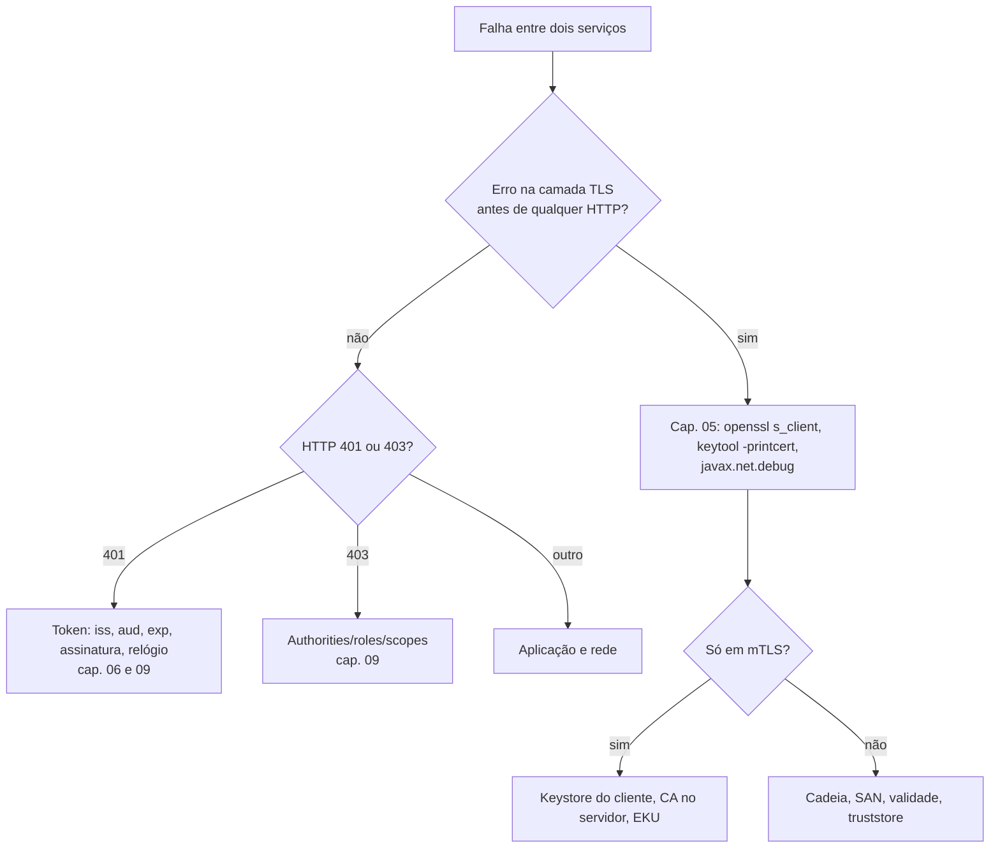

# 12 · Runbooks, checklists e a aula de 30 minutos

**[← 11 · Spring Boot no Kubernetes com certificados](11-spring-boot-kubernetes.md) · [Sumário](../README.md) · [13 · Glossário →](13-glossario.md)**

> **Analogia:** o **manual da portaria**. Quando o banco recusa o documento às duas da manhã, ninguém quer filosofar sobre cartórios: quer a tabela "sintoma → causa → o que fazer".

## Tabela de incidentes (a primeira a abrir)

| Sintoma | Causa mais provável | Confirmar com | Resolver |
|---|---|---|---|
| `PKIX path building failed` | raiz/intermediária fora do truststore, ou cadeia incompleta no servidor | `openssl s_client -showcerts`; `jcmd <pid> VM.system_properties \| grep ssl` | importar a **raiz** no truststore certo; servidor enviar `fullchain` |
| `No subject alternative names matching ...` | nome/IP da URL fora do SAN | `openssl x509 -noout -ext subjectAltName` | reemitir com SAN; ajustar URL |
| `certificate expired` | certificado vencido (qualquer da cadeia) | `openssl x509 -noout -dates` | renovar; reiniciar/recarregar |
| Falha **só em um pod/ambiente** | truststores diferentes | comparar imagem, `JAVA_TOOL_OPTIONS`, volumes | padronizar |
| Funciona no browser, falha na JVM | servidor sem intermediária; ou proxy corporativo | `openssl s_client -showcerts` | corrigir `fullchain`; incluir CA do proxy |
| `bad_certificate` / `no bytes` em mTLS | cliente sem certificado aceito | log do **servidor**; keystore do cliente; EKU | configurar keystore/CA/EKU |
| 401 na API, login OK | `iss`/`aud`/assinatura/expiração | decodificar o token (cap. 06) | alinhar `issuer-uri`, audience, relógio |
| 403 na API, 401 não | falta authority/role | `jwt.claims` vs conversor | conversor de roles (cap. 09) |
| 401 de madrugada, ok de manhã | token expirado sem renovação | `exp` vs relógio | `OAuth2AuthorizedClientManager` |
| API cai após rotação de chave do IdP | chave pública fixa ou cache sem refresh | log de `kid` desconhecido | usar `issuer-uri`/`jwk-set-uri` |
| App falha ao buscar JWKS | truststore da app não confia no IdP | `keytool -printcert -sslserver idp:443` | adicionar a CA do IdP |
| Pod reinicia ao ativar HTTPS na probe | probe sem certificado de cliente em mTLS | `kubectl describe pod` | porta de gerência separada |
| Cert renovado, app segue com o antigo | consumidor não recarrega, ou `subPath` | data de `tls.crt` no pod vs no Secret | `rollout restart`; montar diretório |

## Árvore de decisão geral

## Checklist de revisão de código (PR)

- [ ] Nenhum `TrustAllCerts`, `HostnameVerifier` permissivo ou `-k`
- [ ] Nenhuma chave, senha ou `client_secret` no repositório
- [ ] `JwtDecoder` valida `iss` e `aud`; algoritmo vem da configuração
- [ ] Access token **não** é logado
- [ ] `permitAll()` restrito ao necessário (health)
- [ ] Truststore/keystore vêm de arquivos montados, não do código
- [ ] Testes de autorização (403/401) existem

## Checklist de prontidão (antes de ir para produção)

- [ ] Certificados com SAN, prazo curto e renovação automatizada
- [ ] Monitoramento de dias para o vencimento + alerta
- [ ] CA interna distribuída a todos os clientes
- [ ] Runbook (esta tabela) linkado no manual de on-call
- [ ] Simulação de incidente: renovar certificado em ambiente de teste e observar o comportamento da app

## Aula de 30 minutos para liderados

| Min | Bloco | Material |
|---|---|---|
| 0–5 | A história do cartório (por que confiar) | [cap. 00](00-introducao.md) |
| 5–10 | Cadeia: raiz, intermediária, folha | [cap. 02](02-certificados-e-pki.md) |
| 10–15 | Demonstração: `./cenarios.sh` (sucesso e falhas) | [`labs/tls-java`](../labs/tls-java/) |
| 15–20 | keystore × truststore × `cacerts` e a pegadinha do `-Djavax.net.ssl.trustStore` | [cap. 04](04-java-keystore-truststore.md) |
| 20–25 | JWT: abrir um token, adulterar, ver a assinatura falhar | [`labs/jwt-bash`](../labs/jwt-bash/) |
| 25–30 | Exercício: "dado este erro, qual das 4 causas?" | tabela acima |

### Exercício de fixação (gabarito no fim)

1. A app Java falha em `https://pagamentos.corp` com `PKIX path building failed`; o Chrome abre normalmente. Quais as **duas** hipóteses mais prováveis?
2. A API devolve 401 com um token que o Keycloak acabou de emitir. Cite **três** claims que você conferiria.
3. O certificado foi renovado no cert-manager, mas o pod continua apresentando o antigo. Cite **duas** causas.
4. Por que importar o certificado **folha** do servidor no truststore é uma solução frágil?

**Gabarito:**
1. (a) o servidor não envia a intermediária (o Chrome completa a cadeia, a JVM não); (b) a CA que assina o certificado (por exemplo, a da inspeção TLS do proxy corporativo) não está no truststore que a JVM usa.
2. `iss`, `aud`, `exp` (também `nbf`/assinatura/`kid`).
3. Montagem com `subPath` (não atualiza); consumidor sem suporte a recarga (precisa de restart).
4. Porque a folha muda a cada renovação; o certo é confiar na **CA** que a emite.

## As 10 frases para decorar

1. **Chave privada nunca sai de quem a gerou.**
2. **Certificado é público; a prova de posse é a chave privada.**
3. **Truststore = em quem confio. Keystore = quem sou eu.**
4. **A JVM não usa o repositório do sistema: usa `cacerts` (ou o que você apontar).**
5. **Definir `trustStore` substitui o `cacerts`.**
6. **O servidor deve enviar folha + intermediárias.**
7. **O nome está no SAN, não no CN.**
8. **JWT é lido por qualquer um; o que protege é a assinatura.**
9. **O algoritmo aceito vem da configuração, nunca do token.**
10. **Sempre valide `iss`, `aud` e `exp`.**

**[← 11 · Spring Boot no Kubernetes com certificados](11-spring-boot-kubernetes.md) · [Sumário](../README.md) · [13 · Glossário →](13-glossario.md)**
